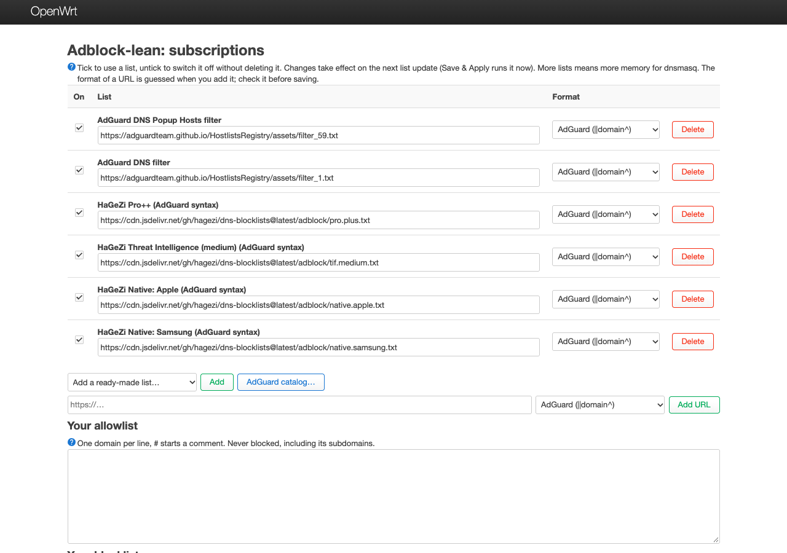

# adblock-lean-plus

DNS ad and tracker blocking for OpenWrt routers, built on
[adblock-lean](https://github.com/lynxthecat/adblock-lean) and dnsmasq, with a LuCI web interface
and encrypted DNS upstreams. A lighter replacement for AdGuard Home on a router.

- **adblock-lean fork** ([`adblock-lean/`](adblock-lean/), changes in [FORK-NOTES](adblock-lean/FORK-NOTES.md)):
  AdGuard-syntax lists (AdGuard DNS filter, AdGuard Home's catalog, HaGeZi `adblock` lists) used directly,
  optional filtering from the first second after boot (`--persist`), survives `sysupgrade`.
- **LuCI app** ([`luci-app/`](luci-app/), changes in [FORK-NOTES](luci-app/FORK-NOTES.md)): subscriptions you can
  switch off without deleting, AdGuard Home's list catalog, format detection, update schedule, status.
- **DoH upstreams** ([`config/https-dns-proxy`](config/https-dns-proxy)): https-dns-proxy with Cloudflare,
  AdGuard (unfiltered) and Quad9, no plain-DNS fallback.

## Screenshots

| Status | Subscriptions | AdGuard Home's list catalog |
|---|---|---|
| [](docs/screenshots/overview.png) | [](docs/screenshots/subscriptions.png) | [](docs/screenshots/adguard-catalog.png) |

The pages are rendered from this repository's view files with data captured from a test router
(LuCI default theme).

## Compared with AdGuard Home

Measured on one router: GL.iNet GL-MT6000 (4 × Cortex-A53, 1 GB RAM), OpenWrt 25.12, AdGuard Home 1.0.0,
the same seven blocklists in both (AdGuard DNS filter, AdGuard Popup Hosts, HaGeZi Pro++, TIF medium,
three HaGeZi "native" lists), DoH upstreams in both. adblock-lean-plus ran on a second dnsmasq instance
next to AdGuard Home; DNS benchmark: 3 × 1000 queries per category from a LAN client.

| | AdGuard Home | adblock-lean-plus |
|---|---|---|
| Blocking result on a 2011-domain test set | reference | identical (incl. 203 exceptions and 8 custom blocks) |
| Memory (RSS) | 162–235 MB (0.107.x: up to 483 MB) | **52 MB** (dnsmasq 46 + DoH proxies 6) |
| With HaGeZi TIF full (1.1M domains) | HaGeZi recommends ≥ 2 GB RAM | dnsmasq 110 MB; ≥ 428 MB stayed free during updates |
| Cached answer, median / p95 | 3 / 5 ms | 2 / 3 ms |
| Blocked domain, median / p95 | 3–4 / 4–7 ms | 2 / 3 ms |
| Uncached queries | depends on upstream | the same (same DoH upstreams) |
| List update (7 lists, BusyBox only) | in the background | 51 s (TIF full: 140 s), once a day |
| Filtering right after boot | yes | with `--persist` (early boot script); otherwise after the lists are loaded |
| Web UI cost | always running | none unless a page is open; no measurable effect on DNS latency |
| Query log, statistics, per-client rules | yes | no |

What you lose: AdGuard Home's query log, statistics and per-client settings. Blocking is silent: dnsmasq
does not log queries, adblock-lean logs only its own updates.

## Requirements

- OpenWrt with dnsmasq 2.86 or newer (OpenWrt 23.05+), `apk` or `opkg`.
- About 6 MB free on `/overlay` (+15 MB with `--persist`). The list preset follows the router's RAM, as in adblock-lean:
  mini (64 MB), small (128 MB), medium (256 MB), large (512 MB), huge (1 GB: HaGeZi Pro + TIF full).
- LuCI for the web pages (optional).

## Install

From a computer with SSH access to the router:

```sh
git clone <repository URL> adblock-lean-plus && cd adblock-lean-plus
./install.sh --dry-run root@192.168.1.1     # check the router, change nothing
./install.sh --gui --doh root@192.168.1.1   # blocker + LuCI pages + DoH proxies
```

| Option | What it does |
|---|---|
| *(none)* | the blocker only: scripts, configs, dnsmasq `addnmount` entries |
| `--gui` | LuCI pages: Services → Adblock-lean |
| `--doh` | `apk update` (or `opkg update`), then https-dns-proxy with the three DoH upstreams (config written first, so the package leaves dnsmasq and the firewall alone; an existing config is kept only if it is equally safe) |
| `--doh-gui` | also `luci-app-https-dns-proxy` to edit the DoH upstreams in LuCI |
| `--preset NAME` | mini, small, medium, large or huge (default: chosen from RAM) |
| `--lists adguard` | add AdGuard DNS filter and AdGuard Popup Hosts to the preset's HaGeZi lists |
| `--persist` | keep the blockset on flash: filtering right after boot, but several MB rewritten on every update (good for eMMC/SSD/USB) |
| `--instance NAME` | dnsmasq instance to filter (needed only when there are several) |
| `--start`, `--enable` | download the lists now; start at boot |
| `--upgrade` | replace the scripts of an existing installation, keep configs |

SSH options go in `SSH_OPTS`, e.g. `SSH_OPTS="-p 2222" ./install.sh ...`; one SSH connection is reused for all steps.

The installer does not change dnsmasq's port or upstream servers and does not touch the firewall. At the
end it prints the `uci` commands that point dnsmasq at the DoH proxies.

## Switching from AdGuard Home

AdGuard Home usually owns port 53 and forwards local names to dnsmasq on another port. The switch is:
dnsmasq back on port 53 with the DoH proxies as upstreams, AdGuard Home stopped. Do it in one step and keep
AdGuard Home installed (stopped) until you are sure:

1. `./install.sh --gui --doh --persist --start root@<router>` — the blocklist is loaded into dnsmasq while AdGuard Home
   still answers clients.
2. Carry over AdGuard Home settings you rely on: "Disallowed domains" → local blocklist (LuCI, Subscriptions page);
   DNS rewrites → `uci add_list dhcp.@dnsmasq[0].address='/name/ip'`; domain-specific upstreams → `server=/domain/ip`.
3. Check before switching:
   - clients outside the LAN subnets (VPN, Tailscale) using the router for DNS: dnsmasq's `localservice` answers
     local subnets only;
   - domains that legitimately resolve to private addresses: dnsmasq's rebind protection drops those answers unless
     listed in `rebind_domain`.
4. Switch: stop AdGuard Home (`/etc/init.d/adguardhome stop`), set dnsmasq's port to 53 (`uci delete dhcp.@dnsmasq[0].port`),
   point it at the DoH proxies (commands printed by the installer), `uci commit dhcp && /etc/init.d/dnsmasq restart`.
   Test from a client.
5. When it works: `/etc/init.d/adguardhome disable`, `/etc/init.d/adblock-lean enable`. Remove AdGuard Home later.

Rollback: set the old dnsmasq port and servers back, `/etc/init.d/adguardhome start`.

## DoH upstreams

[`config/https-dns-proxy`](config/https-dns-proxy) runs three proxies on `127.0.0.1:5053/5054/5055`. dnsmasq sends
each query to the fastest of them and re-tests the others from time to time, so one failing proxy is skipped; there is
deliberately no plain-DNS fallback (dnsmasq has no "fallback only" mode, so a plain server would also get normal
traffic). Each proxy resolves its DoH host through
its `bootstrap_dns` addresses only.

To change them: LuCI → Services → HTTPS DNS Proxy (`--doh-gui`), or edit `/etc/config/https-dns-proxy` and
`/etc/init.d/https-dns-proxy restart`. Keep `dnsmasq_config_update '-'` unless you want the package to rewrite dnsmasq.

## Lists

- **Formats:** AdGuard syntax (`||domain^`, `@@` exceptions, `$important`, `$badfilter`, blocking `$dnsrewrite`),
  plain domains, hosts files. dnsmasq-format lists are refused (adblock-lean builds that itself).
- **Browser lists do not work over DNS.** uBlock Origin lists (cosmetic rules, URL parameters, paths) give almost
  nothing: e.g. 70 usable rules out of 669 in "Privacy Essentials". The LuCI page checks a URL's content when you add
  it and warns or refuses.
- Rules that dnsmasq can not express are skipped and counted in the log: wildcards inside a name, regexes,
  `$client`/`$denyallow` and similar, whole-TLD rules (`||xyz^`). `.example.com^` blocks `example.com` too.
- HaGeZi lists are fastest as adblock-lean short ids (`hagezi:pro.plus`, plain domains): no conversion needed.

## Updating

- `./install.sh --upgrade root@<router>` replaces the scripts and keeps the configs.
- Upstream changes: `tools/sync-upstream.sh` pulls adblock-lean (`next-version`) and the LuCI app (`main`) into
  their subtrees; resolve conflicts, run `sh adblock-lean/tests/test-list-conv.sh`, test on a router.
- adblock-lean's own `update` command is disabled in this fork: it would replace the fork with the upstream version.
- The `luci-app/` subtree's upstream package feed and `.apk` are not used: that build is for adblock-lean 0.8.x.

## Uninstall

If dnsmasq uses the DoH proxies, give it other upstreams first, or DNS stops when the proxies are removed:

```sh
ssh root@<router> 'uci -q del dhcp.@dnsmasq[0].server; uci -q del dhcp.@dnsmasq[0].noresolv; uci commit dhcp; /etc/init.d/dnsmasq restart'
```

Then:

```sh
ssh root@<router> '/etc/init.d/adblock-lean uninstall'
ssh root@<router> 'rm -rf /usr/libexec/rpcd/luci.adblock-lean /usr/share/rpcd/acl.d/luci-app-adblock-lean.json \
  /usr/share/luci/menu.d/luci-app-adblock-lean.json /www/luci-static/resources/view/adblock-lean; /etc/init.d/rpcd reload'
ssh root@<router> 'apk del https-dns-proxy luci-app-https-dns-proxy'      # opkg: opkg remove luci-app-https-dns-proxy https-dns-proxy
ssh root@<router> 'rm -rf /etc/adblock-lean /etc/config/https-dns-proxy'  # remaining configs, if not needed
```

`uninstall` stops filtering and removes the scripts, the boot hooks, the saved blockset and the dnsmasq `addnmount`
entries; it keeps the configs in `/etc/adblock-lean`.

## Tests

`sh adblock-lean/tests/test-list-conv.sh` (run on the router or with BusyBox): list sanitizing and AdGuard-syntax
conversion, 21 checks.

## Credits and licence

- [adblock-lean](https://github.com/lynxthecat/adblock-lean) by lynxthecat, friendly-bits and contributors (GPL-2.0).
- [luci-app-adblock-lean](https://github.com/Wildside-UK/luci-app-adblock-lean) by Wildside-UK (GPL-2.0).
- [https-dns-proxy](https://github.com/aarond10/https_dns_proxy) and its OpenWrt package (installed from the OpenWrt feeds).
- Blocklists belong to their authors (AdGuard, HaGeZi and others) and keep their own licences.

This repository is GPL-2.0 ([LICENSE](LICENSE)).
