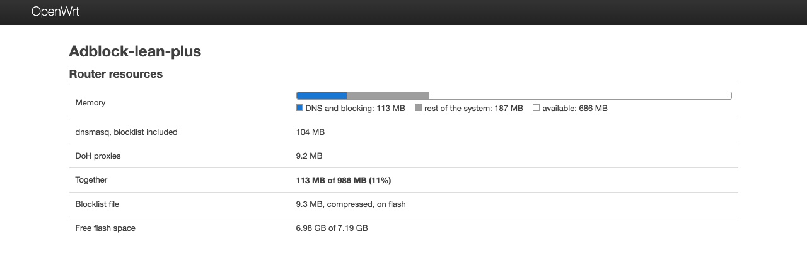

# 🛡️ adblock-lean-plus

**Network-wide ad and tracker blocking for OpenWrt routers: small, fast, managed from LuCI.**

[adblock-lean](https://github.com/lynxthecat/adblock-lean) + dnsmasq do the blocking, a LuCI app manages the lists,
and `https-dns-proxy` encrypts the upstream DNS. A light replacement for AdGuard Home on a router.

[💡 Why](#-why-this-fork) · [📊 Measurements](#-measurements) · [📸 Screenshots](#-screenshots) ·
[🚀 Install](#install) · [🔄 Update](#update) · [🗑️ Uninstall](#uninstall) ·
[🔁 From AdGuard Home](#-if-you-already-run-adguard-home) · [🔧 Details](#-how-it-works) · [🙏 Thanks](#-thanks)

## 💡 Why this fork

AdGuard Home does the job on a router, but it is heavy: on our 1 GB test router version 1.0.0 took 162–244 MB of
RAM (0.107.80 peaked at 483 MB), and HaGeZi advises 2 GB for AdGuard Home with its full threat list. dnsmasq with
adblock-lean needs a fraction of that, but did not give us the same result out of the box. This project puts the
missing pieces together:

| What we missed | What adblock-lean-plus does |
|---|---|
| 📋 *AdGuard DNS filter* and *Popup Hosts* come in AdGuard syntax only; with adblock-lean 0.8.1 we had to convert them by hand into a file that never updated | reads AdGuard-syntax lists directly, exceptions included |
| ⏱️ A window without filtering after every reboot | optional early boot filter: the saved blocklist is loaded before dnsmasq starts |
| 🖱️ The existing LuCI app was written for adblock-lean 0.8.1 | reworked pages: subscriptions you can switch off, AdGuard's list catalog, status, router resources, backup |
| 🔐 Encrypted DNS set up by hand | the installer adds three DoH proxies, switches dnsmasq to them and rolls back if DNS stops working |
| 📦 Several projects to install and wire together | one installer that looks at your router, asks, shows the plan and then installs |
| ⬆️ `sysupgrade` forgets the setup | scripts and settings are kept while "start at boot" is on |

**What you give up** compared with AdGuard Home: the query log, statistics and per-client settings. Blocking is
silent: dnsmasq does not log queries, adblock-lean logs only its own updates.

## 📊 Measurements

All on one router: GL.iNet GL-MT6000 (4 × Cortex-A53, 1 GB RAM), OpenWrt 25.12.

### Against AdGuard Home

The same seven blocklists in both (AdGuard DNS filter, AdGuard Popup Hosts, HaGeZi Pro++, TIF medium, three HaGeZi
"native" lists), DoH upstreams in both. adblock-lean-plus ran on a second dnsmasq instance next to AdGuard Home; DNS
benchmark from a LAN client.

| | AdGuard Home | adblock-lean-plus |
|---|---|---|
| Blocking result on a 2011-domain test set | reference | identical (incl. 203 exceptions and 8 custom blocks) |
| Memory (RSS) | 1.0.0: 162–244 MB; 0.107.80: 247–483 MB | **52 MB** (dnsmasq 46 + DoH proxies 6) |
| With HaGeZi TIF full (1.1M domains) | HaGeZi recommends ≥ 2 GB RAM | dnsmasq 110 MB; ≥ 428 MB stayed free during updates |
| Cached answer, median | 3 ms | 2 ms |
| Blocked domain, median | 3–4 ms | 2 ms |
| Uncached queries | depend on the upstream | no consistent difference |
| List update (7 lists) | in the background | 51 s (TIF full: 140 s), once a day |
| Filtering right after boot | yes | with `--persist` (early boot script); otherwise after the lists are loaded |
| Web UI cost | always running | none unless a page is open; no measurable effect on DNS latency |
| Query log, statistics, per-client rules | yes | no |

AdGuard Home latencies come from runs of 0.107.80 and 1.0.0. The web UI figure was measured before the resources block
was added to the status page.

### In daily use

The same router after switching, with 1,396,525 domains (HaGeZi Pro++ and TIF full, AdGuard lists):

| | |
|---|---|
| 🧠 dnsmasq, blocklist included | 104 MB |
| 🔐 three DoH proxies | 9 MB |
| 🟢 memory still available | 686 MB of 986 MB |
| 💾 saved blocklist on flash | 9.3 MB, compressed |
| 🔄 full list update | 1 min 39 s |
| ♻️ reboot | no unfiltered answer in 200 DNS samples; DNS back after about 80 s |

### Other engines we tried

The pilot before the fork, same lists, DoH through `https-dns-proxy`:

| | adblock-lean 0.8.1 | adblock-fast 1.2.4 |
|---|---|---|
| All lists loaded | yes (AdGuard lists converted by hand) | no: AdGuard Popup Hosts failed to parse |
| Memory | about 52 MB | about 52 MB |
| CPU for 9000 benchmark queries | 16.7 s | 45.8 s |
| List download and load | 17 s | 80 s, ended with an error |

CPU was no argument against AdGuard Home in our runs (13.9 s, measured at another time); the gain is memory.

## 📸 Screenshots

| Status | Router resources |
|---|---|
| [](docs/screenshots/overview.png) | [](docs/screenshots/resources.png) |
| **Subscriptions** | **AdGuard Home's list catalog** |
| [](docs/screenshots/subscriptions.png) | [](docs/screenshots/adguard-catalog.png) |

Rendered from this repository's view files with data captured from a router running it (LuCI default theme).

## ✅ Requirements

- OpenWrt with dnsmasq 2.86 or newer (OpenWrt 23.05+), `apk` or `opkg`.
- About 6 MB free on `/overlay` (+15 MB with `--persist`). The list preset follows the router's RAM, as in adblock-lean:
  mini (64 MB), small (128 MB), medium (256 MB), large (512 MB), huge (1 GB: HaGeZi Pro + TIF full).
- LuCI for the web pages (optional).

## 🚀 Install, update, uninstall

All commands run **on the router** (`ssh root@192.168.1.1`). `git` is not needed.

### Install

**1. Download** (`/tmp` is in RAM: the files disappear on reboot):

```sh
rm -rf /tmp/ablp && mkdir /tmp/ablp && cd /tmp/ablp
wget -O ablp.tar.gz https://codeload.github.com/d1-m4ss/adblock-lean-plus/tar.gz/refs/heads/main
tar -xzf ablp.tar.gz && cd adblock-lean-plus-main
```

**2. Run the installer** and answer its questions:

```sh
sh install.sh
```

It looks at the router first and asks about each part (Enter takes the suggested answer): the web pages, the DoH
proxies, pointing dnsmasq at them, the blocklist options, speed-up tools, start now and at boot. If it finds another
DNS resolver (AdGuard Home, stubby, unbound, …) or `https-dns-proxy` already installed, it says so and suggests
leaving your DNS setup alone. **Nothing changes before you confirm the plan.**

`sh install.sh --dry-run` only shows the plan; `sh install.sh -y` takes every suggested answer.

> 💡 Use the `codeload.github.com` address as written: with `github.com/...` links OpenWrt's `wget` (uclient-fetch)
> hangs until it times out, because GitHub sends a response header longer than it can read.

<details>
<summary><b>The router can not download from GitHub, or you prefer to install from your computer</b></summary>

- Download the archive on your computer, copy it with `scp -O ablp.tar.gz root@192.168.1.1:/tmp/`, then on the router
  run the commands above with `mv /tmp/ablp.tar.gz .` instead of `wget`. If the unpacked directory has another name,
  `cd` into it.
- Or unpack the archive on your computer (macOS or Linux) and run `./install.sh [options] root@192.168.1.1`; it copies
  the files over SSH. SSH options go in `SSH_OPTS`, e.g. `SSH_OPTS="-p 2222" ./install.sh ...`.

</details>

<details>
<summary><b>All installer options</b></summary>

Options answer the questions in advance. Without a terminal (and without `-y`) only what the options ask for is
done.

| Option | What it does |
|---|---|
| *(none)* | in a terminal: ask. The blocker itself (scripts, configs, dnsmasq `addnmount` entries) is always installed |
| `--gui` / `--no-gui` | LuCI pages: Services → Adblock-lean-plus |
| `--doh` / `--no-doh` | `apk update` (or `opkg update`), then https-dns-proxy with the three DoH upstreams (config written first, so the package leaves dnsmasq and the firewall alone). An existing config is kept; the installer stops if it lets the package rewrite dnsmasq or the firewall |
| `--doh-gui` | also `luci-app-https-dns-proxy` to edit the DoH upstreams in LuCI |
| `--use-doh` / `--keep-dns` | point dnsmasq at the DoH proxies (the default with `--doh`) / leave its upstreams alone |
| `--utils` / `--no-utils` | gawk, GNU sed, coreutils-sort: list processing is faster with them |
| `--preset NAME` | mini, small, medium, large or huge (default: chosen from RAM) |
| `--lists adguard` | add AdGuard DNS filter and AdGuard Popup Hosts to the preset's HaGeZi lists |
| `--persist` | keep the blockset on flash: filtering right after boot, but several MB rewritten on every update (good for eMMC/SSD/USB) |
| `--instance NAME` | dnsmasq instance to filter (needed only when there are several) |
| `--start`, `--enable` | download the lists now; start at boot (`--no-start`, `--no-enable`) |
| `--upgrade` | replace the scripts of an existing installation, keep configs |
| `-y`, `--yes` | ask nothing, take the suggested answers |
| `--dry-run` | check the router and show the plan; change nothing |

</details>

### Update

Blocklists update by themselves (once a day between 05:00 and 06:00 once enabled). The plugin is updated by running the new installer
over the old installation; lists, names, local allow/block entries, schedule and DNS settings are kept.

**1. Download** as in [Install](#install), step 1. **2. Run:**

```sh
sh install.sh --upgrade
```

- It asks about anything that can be added to your setup (web pages, speed-up tools, a plain-DNS exception for the
  time servers, …), shows the plan and waits for your confirmation.
- Answer yes to "Download the lists and start blocking now?": adblock-lean restarts with the new scripts (1–3
  minutes; DNS pauses for a few seconds when the new list is loaded).
- Web pages: log out of LuCI and back in. If the old page still shows, reload it without the browser cache (Ctrl+F5,
  on a Mac Cmd+Shift+R).
- Check: `/etc/init.d/adblock-lean status`.
- Also possible: `--dry-run` only shows the plan, `-y` takes every suggested answer; from your computer,
  `./install.sh --upgrade root@192.168.1.1` in the unpacked archive.

<details>
<summary><b>After an OpenWrt firmware upgrade</b></summary>

Upgrade OpenWrt with Attended Sysupgrade (LuCI: System → Attended Sysupgrade, or `owut`), which builds an image that
includes your installed packages. A plain `sysupgrade` that keeps the settings drops added packages such as
`https-dns-proxy` while dnsmasq still forwards to it, so DNS stops working; if that happened, run step 1 of
[Uninstall](#uninstall) to give dnsmasq other servers.

While "start at boot" is on, `sysupgrade` keeps adblock-lean's scripts and settings (listed in
`/lib/upgrade/keep.d`), but not the web pages: run the installer again as above. With "start at boot" off nothing of
adblock-lean is kept: download a [backup](#backup-and-import) first and install again afterwards.

</details>

### Uninstall

Optional: save a [backup](#backup-and-import) first. Run the steps in this order.

**1. Give dnsmasq other DNS servers.** Needed only if it forwards to the DoH proxies, that is, if
`uci get dhcp.@dnsmasq[0].server` shows `127.0.0.1#5053`…`5055`; otherwise go to step 2. Without this step DNS stops
when the proxies are removed. (With several dnsmasq instances, see `uci show dhcp | grep =dnsmasq` and use the
filtered one instead of `@dnsmasq[0]`.)

```sh
for p in 5053 5054 5055; do uci -q del_list dhcp.@dnsmasq[0].server="127.0.0.1#$p"; done
for ip in 1.1.1.1 1.0.0.1; do uci -q del_list dhcp.@dnsmasq[0].server="/pool.ntp.org/$ip"; done
uci -q delete dhcp.@dnsmasq[0].noresolv
uci commit dhcp && /etc/init.d/dnsmasq restart
```

Now dnsmasq uses the DNS servers of your internet connection. **Check it, and do not continue unless it answers**
(give dnsmasq a few seconds to load the blocklist):

```sh
nslookup openwrt.org 127.0.0.1
```

No answer (your connection provides no DNS servers)? Add one, then check again:

```sh
uci add_list dhcp.@dnsmasq[0].server='1.1.1.1' && uci commit dhcp && /etc/init.d/dnsmasq restart
```

**2. Remove the blocker and its settings** (scripts, lists, saved blocklist, boot and cron entries, dnsmasq
`addnmount` entries):

```sh
DO_DIALOGS=0 luci_uninstall_rm_config=y /etc/init.d/adblock-lean uninstall
```

To keep the settings in `/etc/adblock-lean`, run `/etc/init.d/adblock-lean uninstall` instead and answer `n`.

**3. Remove the web pages:**

```sh
rm -rf /usr/libexec/rpcd/luci.adblock-lean /usr/share/rpcd/acl.d/luci-app-adblock-lean.json \
  /usr/share/luci/menu.d/luci-app-adblock-lean.json /www/luci-static/resources/view/adblock-lean \
  /var/run/luci-adblock-lean /tmp/luci-indexcache* /tmp/luci-modulecache
/etc/init.d/rpcd reload
```

**4. Remove the DoH proxies**, if the installer added them (skip this if you used `https-dns-proxy` before):

```sh
apk del luci-app-https-dns-proxy      # opkg: opkg remove luci-app-https-dns-proxy
apk del https-dns-proxy               # opkg: opkg remove https-dns-proxy
rm -f /etc/config/https-dns-proxy*
```

**Check** that DNS works and nothing is left (only the `nslookup` answer should show):

```sh
nslookup openwrt.org 127.0.0.1
ls -d /etc/init.d/adblock-lean* /etc/adblock-lean /usr/lib/adblock-lean 2>/dev/null
uci show dhcp | grep -E 'addnmount|127.0.0.1#505'; crontab -l 2>/dev/null | grep adblock
```

The speed-up tools (gawk, sed, coreutils-sort) are ordinary OpenWrt packages and stay installed.

## 🔁 If you already run AdGuard Home

AdGuard Home (AGH) and adblock-lean-plus both want to be the router's DNS on port 53, so AGH goes first.
Two common AGH setups exist; check yours with `netstat -lntup | grep ':53 '`:

- **AGH on port 53**, dnsmasq moved to another port (e.g. 54) and used by AGH for local names. Most guides do this.
- **dnsmasq on port 53**, forwarding to AGH (e.g. `server=127.0.0.1#5353` or DHCP option 6 pointing clients to AGH).

### 1. Note what to carry over

Save the AGH config first (`/etc/adguardhome/adguardhome.yaml`, older packages: `/etc/adguardhome.yaml`) and note:

| In AGH | In adblock-lean-plus |
|---|---|
| Blocklists (Filters → DNS blocklists) | the same URLs: LuCI → Adblock-lean-plus → Subscriptions → "AdGuard catalog…" or "Add URL" (format is detected), or `install.sh --lists adguard` for AdGuard DNS filter + Popup Hosts |
| Allowlists, custom `@@` rules | local allowlist (Subscriptions page) |
| Disallowed domains, custom block rules | local blocklist (Subscriptions page) |
| DNS rewrites | `uci add_list dhcp.@dnsmasq[0].address='/name/ip'` |
| Upstream DNS (DoH) | `--doh` (Cloudflare, AdGuard unfiltered, Quad9) or your own in `/etc/config/https-dns-proxy` |
| Domain-specific upstreams `[/domain/]ip` | `uci add_list dhcp.@dnsmasq[0].server='/domain/ip'` |
| Query log, statistics, per-client rules | not available |

### 2. Give port 53 back to dnsmasq

Do this from a wired or Wi-Fi client you can test with, and keep a way back (AGH stays installed until step 3).

```sh
/etc/init.d/adguardhome stop
uci -q delete dhcp.@dnsmasq[0].port          # AGH-on-53 setup: dnsmasq back to port 53
uci -q del_list dhcp.@dnsmasq[0].server='127.0.0.1#5353'   # your forward to AGH, if any (see below)
uci set dhcp.@dnsmasq[0].noresolv='0'        # for now use the WAN's DNS servers
uci set dhcp.@dnsmasq[0].cachesize='10000'   # AGH setups often set 0 (AGH did the caching)
uci commit dhcp && /etc/init.d/dnsmasq restart
```

`uci get dhcp.@dnsmasq[0].server` lists dnsmasq's upstreams: remove the ones pointing to AGH (the port above is an
example) and old general upstreams the same way; keep per-domain entries such as `/lan.example/10.0.0.2`.

If DHCP option 6 or a firewall redirect points clients to AGH's address or port, point it at the router / port 53.
Open a few sites from a client. If something fails: `/etc/init.d/adguardhome start` and restore the old values.

### 3. Remove AdGuard Home

```sh
/etc/init.d/adguardhome disable
apk del adguardhome                     # opkg: opkg remove adguardhome
rm -rf /etc/adguardhome /var/lib/adguardhome   # config and work dir (query log), after your backup
```

### 4. Install adblock-lean-plus

On the router, download and unpack as in [Install](#install), then:

```sh
sh install.sh
```

Answer yes to the DoH proxies and to pointing dnsmasq at them, add your lists from step 1 on the
Subscriptions page, then check from a client: `nslookup doubleclick.net` → no address (NXDOMAIN, with lists that
block it), normal sites resolve.

**No-gap variant:** install while AGH still answers (the lists load into dnsmasq on its other port): answer yes to
starting now, and no to pointing dnsmasq at the DoH proxies if AGH forwards to dnsmasq. Then do steps 2–3 and, if you
skipped it, run `sh install.sh --upgrade --use-doh`; filtering starts the moment dnsmasq takes port 53.

## 🔧 How it works

### What happens to your DNS settings

If you let the installer point dnsmasq at the DoH proxies, it

1. checks that the proxies answer,
2. replaces dnsmasq's general upstream servers with them (per-domain entries such as `/lan.example/10.0.0.2` are kept),
3. resolves the names of your time servers over plain DNS (`server=/pool.ntp.org/1.1.1.1` and `1.0.0.1`),
4. restarts dnsmasq and checks that it resolves; if not, the previous settings are put back. Time server names that
   do not resolve over plain DNS (blocked on your network) get no exception.

Step 3 matters after a long power cut: a router has no battery clock, encrypted DNS needs a correct time (TLS
certificates), and setting the time needs DNS. The time server names are the only queries that leave unencrypted.

The installer does not change dnsmasq's port and does not touch the firewall.

### DoH upstreams

[`config/https-dns-proxy`](config/https-dns-proxy) runs three proxies on `127.0.0.1:5053/5054/5055`. dnsmasq sends
each query to the fastest of them and re-tests the others from time to time, so one failing proxy is skipped; there is
deliberately no plain-DNS fallback (dnsmasq has no "fallback only" mode, so a plain server would also get normal
traffic). Each proxy resolves its DoH host through
its `bootstrap_dns` addresses only.

To change them: LuCI → Services → HTTPS DNS Proxy (`--doh-gui`), or edit `/etc/config/https-dns-proxy` and
`/etc/init.d/https-dns-proxy restart`. Keep `dnsmasq_config_update '-'` unless you want the package to rewrite dnsmasq.

### Lists

- **Formats:** AdGuard syntax (`||domain^`, `@@` exceptions, `$important`, `$badfilter`, blocking `$dnsrewrite`),
  plain domains, hosts files. dnsmasq-format lists are refused (adblock-lean builds that itself).
- **Browser lists do not work over DNS.** uBlock Origin lists (cosmetic rules, URL parameters, paths) give almost
  nothing: e.g. 70 usable rules out of 669 in "Privacy Essentials". The LuCI page checks a URL's content when you add
  it and warns or refuses.
- Rules that dnsmasq can not express are skipped and counted in the log: wildcards inside a name, regexes,
  `$client`/`$denyallow` and similar, whole-TLD rules (`||xyz^`). `.example.com^` blocks `example.com` too.
- HaGeZi lists are fastest as adblock-lean short ids (`hagezi:pro.plus`, plain domains): no conversion needed.

### Backup and import

LuCI → Services → Adblock-lean-plus, section **Backup**: "Download backup" saves one JSON file with the subscriptions
(including the switched-off ones and your names for them), the local allowlist and blocklist, the update schedule and "start at boot";
"Import…" restores them, for example on a new router. The router checks the whole file before anything is written;
then choose "Update lists now". Not in the file: DNS/DoH settings, the size limits of the preset and other options of the
adblock-lean config files (such as allowlist-only mode). A hand-written
update schedule (not "daily at …") is saved but not restored. Importing "start at boot: no" also stops blocking.

### Input limits

List addresses and names are restricted, on the page and again on the router: an `http(s)` URL (up to 500 characters
of letters, digits and `. _ ~ : / ? % + @ , -`) or a short id such as `hagezi:pro`; a name of up to 80 letters, digits,
spaces and `. , : ' ( ) / + & _ -` (any alphabet). The local allowlist and blocklist take one domain per line
(letters, digits, `. _ -`, optionally `*.`) and `#` comments with the same characters as names plus `#` and `*`; the
domain check takes a plain domain name.

### Firewall (optional)

adblock-lean-plus needs no firewall changes: clients use the router as DNS (DHCP option 6) and dnsmasq filters.
Devices with a hard-coded DNS server (e.g. 8.8.8.8) bypass it; a redirect sends their plain DNS to the router:

```sh
uci set firewall.dns_redirect=redirect
uci set firewall.dns_redirect.name='Force-DNS-to-router'
uci set firewall.dns_redirect.src='lan'
uci set firewall.dns_redirect.src_dport='53'
uci set firewall.dns_redirect.dest_port='53'
uci set firewall.dns_redirect.proto='tcp udp'
uci set firewall.dns_redirect.target='DNAT'
uci commit firewall && /etc/init.d/firewall reload
```

Encrypted DNS inside apps and browsers (DoH/DoT) can not be redirected; the HaGeZi "Encrypted DNS/VPN/Proxy bypass"
preset blocks the names of public DoH servers, so most browsers fall back to the router.

## 🛠️ For maintainers

- Code and changes: [`adblock-lean/`](adblock-lean/) ([FORK-NOTES](adblock-lean/FORK-NOTES.md)),
  [`luci-app/`](luci-app/) ([FORK-NOTES](luci-app/FORK-NOTES.md)), [`config/https-dns-proxy`](config/https-dns-proxy).
- Upstream changes (in a git checkout): `tools/sync-upstream.sh` pulls adblock-lean (`next-version`) and the LuCI app
  (`main`) into their subtrees; resolve conflicts, run the tests, test on a router.
- Tests: `sh adblock-lean/tests/test-list-conv.sh` (on the router or with BusyBox): list sanitizing and AdGuard-syntax
  conversion, 21 checks.
- adblock-lean's own `update` command is disabled in this fork: it would replace the fork with the upstream version.
- The `luci-app/` subtree's upstream package feed and `.apk` are not used: that build is for adblock-lean 0.8.x.

## 🙏 Thanks

This project is mostly other people's good work, put together:

| Project | Authors | What it gives us |
|---|---|---|
| [adblock-lean](https://github.com/lynxthecat/adblock-lean) (GPL-2.0) | lynxthecat, friendly-bits and contributors | the blocking engine this fork is built on |
| [luci-app-adblock-lean](https://github.com/Wildside-UK/luci-app-adblock-lean) (GPL-2.0) | Wildside-UK | the base of the web pages |
| [https_dns_proxy](https://github.com/aarond10/https_dns_proxy) | aarond10 and contributors | the DoH client |
| [https-dns-proxy for OpenWrt](https://github.com/mossdef-org/https-dns-proxy) and its LuCI app | Stan Grishin and the OpenWrt LuCI community | packaging, service and settings page |
| [HaGeZi DNS blocklists](https://github.com/hagezi/dns-blocklists) | HaGeZi | the default lists |
| [AdGuard Hostlists Registry](https://github.com/AdguardTeam/HostlistsRegistry) | AdGuard and list authors | AdGuard DNS filter and the list catalog |
| [OISD](https://oisd.nl), [Steven Black's hosts](https://github.com/StevenBlack/hosts), [Dandelion Sprout](https://github.com/DandelionSprout/adfilt) | their authors | ready-made lists |
| [yokoffing/filterlists](https://github.com/yokoffing/filterlists) | yokoffing | recommendations behind the preset selection |
| [dnsmasq](https://thekelleys.org.uk/dnsmasq/doc.html) and [OpenWrt](https://openwrt.org) | Simon Kelley, the OpenWrt developers | what it all runs on |

Blocklists belong to their authors and keep their own licences. This repository is GPL-2.0 ([LICENSE](LICENSE)).
